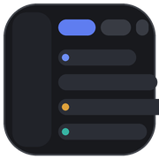

# dsh-sidebar-session-tabs

A community plugin for [DeepSeek Harness](https://github.com/deepseek-ai/deepseek-harness) that puts a **filter tab strip** above the sidebar's session list and lets you **tag sessions**.

English | [中文](README.zh.md)



## Why this is a fork

The sidebar's browsing region is the single-occupant slot `sidebar.workspaces`. Its section header, search box, session tree, row menus and dialogs all live inside one component, and the slot declares no extension point between the header and the list — so a separate plugin cannot add a row there.

This package therefore ships a fork of `@deepseek-ai/dsh-client-ui-workspace`'s Client bundle with the tab strip and tags added, and a patch that disables the shipped row so the two registrations cannot coexist. Everything else in the region is upstream code with its behaviour intact.

## Features

- **Filter tabs** under the *Workspaces* header: `All`, `Running`, `Needs me`, `Pinned`, plus one tab per user tag. Each tab carries a live count.
- **`+` creates a tag tab**; **double-click** renames it; **right-click** opens rename/delete. Deleting a tag also drops that tag's assignments; deleting the active tag falls back to `All`.
- **Session row menu → `Tags…`** opens a dialog listing every tag as a checkbox, with an inline field that creates a tag and assigns it in one step.
- **Tag dots on rows** — up to three colored dots per tagged session; the hover card lists the tag names.
- **Auto-expand on filter** — switching to a filter tab opens every workspace that still has matches; the saved expand/collapse state is not rewritten.
- **Unchanged from upstream**: the `session.search` shortcut and search results (including content search), drag reordering of sessions and workspaces, the manual/updated sort order, grouping modes, pin / rename / fork / archive / copy-id row actions and their hover buttons, workspace rename and delete, add workspace, the stop-and-archive confirmation, row notices, and the blank-session workspace picker.

Filter semantics:

| Tab | Shows |
| --- | --- |
| `All` | The unfiltered list, exactly as upstream derives it |
| `Running` | Sessions whose UI status reports running work (children included through their own status) |
| `Needs me` | Sessions with a pending approval, plan review, or user question |
| `Pinned` | Sessions in the registry-global pin set |
| a tag tab | Sessions carrying that tag |

The current blank draft stays visible in every tab, and archived sessions keep following the region's own archived filter rather than the tabs.

## Install

Prerequisites: a Harness profile that exposes the `plugin_manager` tool (the `web` profile does) and dsh 0.2.x.

1. Install the bundle — either ask the agent in the Harness, or call the `plugin_manager` tool:

   ```
   action: install_bundle
   target: github:Zekilou/dsh-sidebar-session-tabs
   ```

   A prebuilt tarball is attached to every release, which skips the build-approval step:

   ```
   action: install_bundle
   target: https://github.com/Zekilou/dsh-sidebar-session-tabs/releases/download/v0.1.0/dsh-sidebar-session-tabs.tgz
   ```

   From a local clone, pass its absolute path instead.

2. Reload the Harness Web page once; the Client bundle registers on boot.
3. The session list now has the tab strip. The shipped browsing region is replaced by this package's row, which is why installing it disables `ui-workspace`; removing or disabling this bundle restores the shipped region.

## Compatibility

The bundle was forked from the `0.2.1-rc.5` Client bundle and its `engines.dsh` is `>=0.2.1-rc.5 <0.3.0-0`. A different Harness frontend may have changed the slot props, the CSS custom properties, or the `uiWorkspace` service shape this fork registers, so other versions are unsupported until the fork is re-synced.

Tags and the selected tab are client-local: they persist in `localStorage` under `dsh.sidebarSessionTabs.v1` and do not travel between browsers, profiles, or machines. The session log is untouched — a tag is UI metadata, not a session event.

## Maintenance: re-syncing the fork

Upstream changes to the browsing region do **not** reach this package automatically. To re-sync against a newer Harness:

1. Copy the installed bundle: `cp <dsh>/node_modules/@deepseek-ai/dsh-client-ui-workspace/lib/client.js client.js`.
2. Re-apply the identity renames (`client.js` header comment, `window.__ModuleLoader__.load({ id })`, the CSS `tagId`/`dataset.plugin` strings) and restore the `local/session-filter-tabs` region plus the file header.
3. Re-apply the integration points: the filter memos and tab row in `WorkspaceBrowser`, the narrowed `list`/`workspaces` arguments passed to `SessionTree`/`FlatList`, `SessionNodeItem`'s tag dots and hover-card line, `EmptySessions`' filtered copy, the `tabs.*` / `tags.*` dictionary keys, and the `session-tags` menu row plus `workspace.session-tags` dialog registrations in `apply`.
4. Bump the version, cut a release, and refresh the installed bundle.

## License

MIT — see [LICENSE](LICENSE). Forked portions are MIT-licensed by DeepSeek; what was copied and what was added is recorded in [THIRD_PARTY_NOTICES.md](THIRD_PARTY_NOTICES.md).