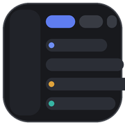

# dsh-sidebar-session-tabs

给 [DeepSeek Harness](https://github.com/deepseek-ai/deepseek-harness) 侧栏会话列表加一条**筛选 Tab 条**，并给会话**打标签**的社区插件。

[English](README.md) | 中文



## 为什么是 fork

侧栏浏览区是单占位槽 `sidebar.workspaces`：header、搜索框、会话树、行菜单、对话框全在这一个组件里，槽本身也没有「在 header 和列表之间插一行」的扩展点。所以独立插件没有地方放 Tab 条。

这个包因此随包发了一份 `@deepseek-ai/dsh-client-ui-workspace` Client bundle 的 fork（加了 Tab 条与标签），并附带一条 patch 把 shipped 的那一行 disable 掉，避免两套注册共存。该区域的其他部分都是上游代码，行为不变。

## 功能

- **筛选 Tab**（在「工作区」header 下方）：`全部`、`运行中`、`待我处理`、`已固定`，外加每个自定义标签一个 Tab；每个 Tab 带实时数量。
- **`+` 新建标签 Tab**；**双击**改名；**右键**出重命名/删除菜单。删除标签会一并清掉该标签的分配；删掉的若是当前 Tab，回落到 `全部`。
- **会话行「…」菜单 → `标签…`**：弹窗里逐条勾选，底部可新建标签并立即打上。
- **行内彩色标签圆点**（最多 3 个），悬停卡片里列出标签名。
- **筛选时自动展开**有匹配会话的工作区；不写回你保存的展开/折叠状态。
- **上游原有能力不变**：`session.search` 快捷键与搜索结果（含内容搜索）、会话与工作区拖拽排序、手动/最近更新排序、分组模式、固定/重命名/分叉/归档/复制 ID 及其悬停按钮、工作区重命名与删除、添加工作区、「停止并归档」确认、行提示、空态工作区选择器。

筛选语义：

| Tab | 显示 |
| --- | --- |
| `全部` | 完全按上游推导的未筛选列表 |
| `运行中` | UI 状态里正在跑的会话（子会话按自身状态统计） |
| `待我处理` | 有待审批、计划审核或待回答提问的会话 |
| `已固定` | 注册表全局固定集合 |
| 标签 Tab | 带该标签的会话 |

当前空白草稿在每个 Tab 都保留；已归档会话仍跟随该区域自己的归档筛选，不跟 Tab 联动。

## 安装

前提：暴露 `plugin_manager` 工具的 Harness profile（`web` profile 自带），dsh 0.2.x。

1. 安装 bundle —— 让 Harness 里的 agent 安装，或直接调用 `plugin_manager`：

   ```
   action: install_bundle
   target: github:Zekilou/dsh-sidebar-session-tabs
   ```

   每个 release 附了预构建 tarball，可免掉构建授权：

   ```
   action: install_bundle
   target: https://github.com/Zekilou/dsh-sidebar-session-tabs/releases/download/v0.1.0/dsh-sidebar-session-tabs.tgz
   ```

   本地 clone 就直接传绝对路径。

2. 刷新一次 Harness Web 页面，Client bundle 会在启动时注册。
3. 会话列表就会出现 Tab 条。shipped 浏览区被本包这一行替换，因此安装会 disable `ui-workspace`；移除或停用本 bundle 即恢复原区域。

## 兼容性

bundle 从 `0.2.1-rc.5` 的 Client bundle fork 而来，`engines.dsh` 为 `>=0.2.1-rc.5 <0.3.0-0`。换了 Harness 前端版本，这个 fork 依赖的槽 props、CSS 变量与 `uiWorkspace` 服务形状都可能变化，未重新同步前不做兼容承诺。

标签与当前 Tab 是客户端本地数据：存在 `localStorage` 的 `dsh.sidebarSessionTabs.v1`，不跨浏览器 / profile / 机器。会话日志完全不动——标签是 UI 元数据，不是会话事件。

## 维护：重新同步 fork

上游浏览区的改动**不会**自动进入这个包。对齐新版本 Harness 的步骤：

1. 复制已安装的 bundle：`cp <dsh>/node_modules/@deepseek-ai/dsh-client-ui-workspace/lib/client.js client.js`。
2. 重做身份改名（`client.js` 头注释、`window.__ModuleLoader__.load({ id })`、CSS `tagId`/`dataset.plugin`），并恢复 `local/session-filter-tabs` 区块与文件头。
3. 重打集成点：`WorkspaceBrowser` 里的筛选 memo 与 Tab 条渲染、传给 `SessionTree`/`FlatList` 的收窄 `list`/`workspaces` 参数、`SessionNodeItem` 的标签圆点与悬停卡片行、`EmptySessions` 的筛选文案、两份字典的 `tabs.*` / `tags.*`、以及 `apply` 里的 `session-tags` 菜单行与 `workspace.session-tags` 对话框注册。
4. 升版本、发 release、刷新已安装的 bundle。

## 许可

MIT，见 [LICENSE](LICENSE)。fork 部分为 DeepSeek 的 MIT 代码；复制了什么、加了什么记在 [THIRD_PARTY_NOTICES.md](THIRD_PARTY_NOTICES.md)。